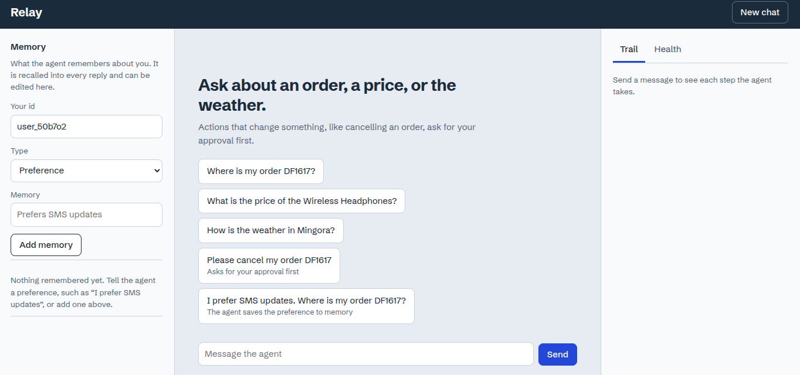
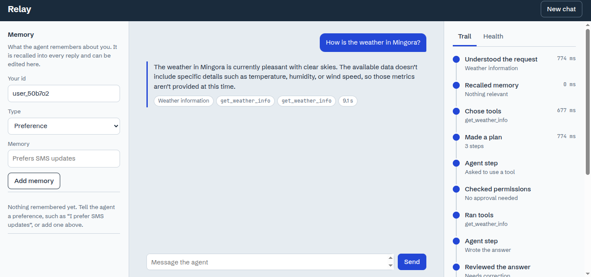
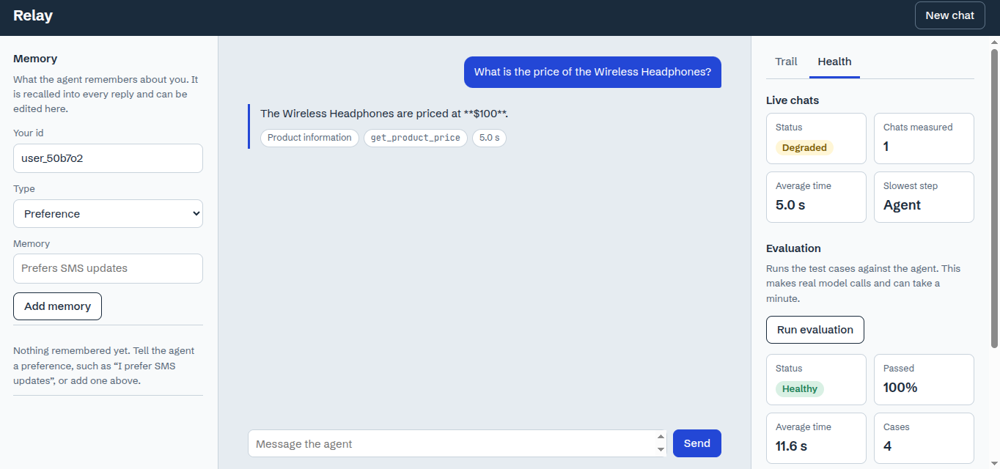
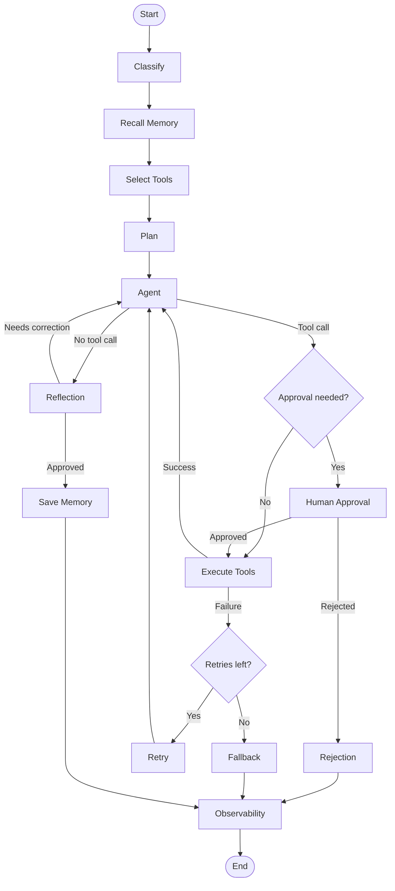

# Agent Project

A tool-using AI agent built with [LangGraph](https://github.com/langchain-ai/langgraph), served through a FastAPI backend. It classifies each request, selects tools, plans, executes with human approval for sensitive actions, recovers from failures, and reflects on its own answer. Built in are execution tracing, per-user memory, and an evaluation and reliability suite.

## Features

- **Intent classification, tool selection, planning, reflection**: a multi-step LangGraph pipeline
- **Human-in-the-loop approval**: sensitive tools (e.g. `cancel_order`) pause the graph until a human approves or rejects, over the API or the terminal
- **Retry and fallback**: failed tool calls are retried, then answered gracefully
- **Observability**: per-node and per-tool timings for every run, with aggregated health
- **Memory**: per-user long-term memory that the agent recalls into its prompts and updates after each turn
- **Evaluation and reliability**: accuracy metrics, failure analysis, health status, regression detection
- **REST API**: chat, SSE streaming, approvals, memory, monitoring, and evaluation endpoints
- **Chat UI**: a no-build web console (chat, approval prompts, live step trail, memory editor, health) served by the API

## Screenshots
 
**Before chat**: suggested prompts, an empty memory panel, and an empty step trail.
 

 
**After chat**: the reply with its tool and memory chips, the memory the agent saved, and the step-by-step trail with timings.
 

 
**Health**: live latency and status, plus the evaluation results.
 



## Workflow



## Project Structure

```
agent_project/
├── configs/config.yaml
├── frontend/                 # chat UI (index.html, styles.css, app.js)
├── src/
│   ├── agent/
│   │   ├── graph.py          # nodes, routers, compiled graph
│   │   ├── state.py          # AgentState and structured-output schemas
│   │   ├── tools.py          # tools, registry, helpers
│   │   └── memory.py         # MemoryStore / MemoryManager, relevance ranking
│   ├── observability/
│   │   ├── models.py         # TraceEvent and report models
│   │   ├── tracing.py        # NodeTimer, TraceAnalyzer
│   │   └── store.py          # ObservabilityStore, ObservabilityAggregator
│   ├── evaluation/
│   │   ├── test_cases.py     # evaluation dataset
│   │   ├── evaluator.py      # evaluate_case, failure reasons
│   │   ├── metrics.py        # result schema, metrics, report
│   │   ├── production.py     # ProductionEvaluator, ProductionRunStore
│   │   └── reliability.py    # failure analysis, health, regression
│   ├── api/
│   │   ├── main.py           # FastAPI app
│   │   ├── schemas.py        # request/response models
│   │   ├── dependencies.py   # shared stores and analyzers
│   │   └── routes/           # chat.py, memory.py, monitoring.py
│   └── utils/                # config.py, logging.py
├── tests/
├── evaluate.py               # CLI evaluation entry point
├── requirements.txt
└── README.md
└── docs/
    └── screenshots/         # 3 pics 
```

## Getting Started

**Prerequisites:** Python 3.10+ and a [Groq](https://console.groq.com) API key (or a local [Ollama](https://ollama.com) install).

```bash
git clone https://github.com/<your-username>/agent_project.git
cd agent_project

python -m venv .venv
source .venv/bin/activate        # Windows: .venv\Scripts\activate
pip install -r requirements.txt

cp .env.example .env             # then add your GROQ_API_KEY
```

To use Ollama instead, set `model.provider: ollama` and `model.name: mistral` in `configs/config.yaml`, then run `ollama pull mistral`.

## Run the API

```bash
uvicorn src.api.main:app --reload
```

Interactive docs are at http://localhost:8000/docs (OpenAPI schema at `/openapi.json`).

### Endpoints

| Method | Path | Description |
|---|---|---|
| GET | `/health` | Service and model info |
| POST | `/api/chat` | Send a message; omit `thread_id` to start a conversation, pass `user_id` to enable memory |
| POST | `/api/chat/stream` | Same, streamed as Server-Sent Events (`thread`, `node`, `final`, `error`) |
| POST | `/api/chat/{thread_id}/approval` | Approve or reject a paused action: `{"approved": true}` |
| POST | `/api/chat/{thread_id}/approval/stream` | Same, streamed as Server-Sent Events |
| GET | `/api/chat/{thread_id}` | Thread status and message history |
| POST / GET | `/api/users/{user_id}/memories` | Create / list (`?memory_type=`, `?q=`) |
| GET / PATCH / DELETE | `/api/users/{user_id}/memories/{memory_id}` | Read / update / delete |
| GET | `/api/observability/dashboard` | Aggregated latency and health of live chats |
| GET | `/api/observability/threads/{thread_id}` | Timing report for one thread |
| POST | `/api/evaluation/run` | Run the evaluation dataset (makes LLM calls) |
| GET | `/api/evaluation/dashboard` | Latest evaluation with regression check |
| GET | `/api/evaluation/reliability` | Reliability snapshot by component |

### Approval flow

```
POST /api/chat  {"message": "Please cancel my order DF1617"}
→ {"thread_id": "abc", "status": "awaiting_approval",
   "approval": {"pending_tool_calls": [{"name": "cancel_order", "args": {"order_id": "DF1617"}}], ...}}

POST /api/chat/abc/approval  {"approved": true}
→ {"thread_id": "abc", "status": "completed", "response": "Order DF1617 is cancelled successfully.", ...}
```

## Chat UI

Start the API and open http://localhost:8000. The UI is plain HTML, CSS and JS in `frontend/` (no build step) and is served by FastAPI, so there is nothing else to run.

- Chat with live progress; the **Trail** tab shows each step the agent took and how long it took
- Approve or reject sensitive actions in the conversation
- **Memory** panel to view, add, and remove what the agent remembers
- **Health** tab for live latency and a one-click evaluation run

To host the UI elsewhere, open it with `?api=http://your-api-host:8000` and add that origin to `api.cors_origins` in the config.

## Memory

Pass a `user_id` with each chat request to turn memory on for that user.

1. **Recall**: before planning, the agent loads the memories most relevant to the request (word overlap, then most recent) and adds them to its prompts as stored data, not instructions.
2. **Save**: after a successful answer, the agent extracts new preferences, facts, or goals the user stated and stores them. Duplicates are skipped, and a failure here never fails the reply.

The chat response lists `memories_used` and `memories_saved`. Settings are under `memory:` in the config (`enabled`, `auto_extract`, `max_context_items`, `max_new_per_turn`).

## Terminal usage and evaluation

```python
from src.agent.graph import run_conversation
run_conversation("Where is my order DF1617?", thread_id="demo_1", user_id="demo_user")
```

```bash
python evaluate.py   # accuracy metrics + reliability report
```

Evaluation auto-approves gated tools (`evaluation.auto_approve` in the config).

## Tests

```bash
pip install -r requirements-dev.txt
pytest
```

Tests use a scripted fake LLM, so they run offline and need no API key.

## Configuration

`configs/config.yaml` controls the model provider and name, agent limits, slow-node/tool thresholds, health thresholds, evaluation behaviour, CORS origins, and the log level. Secrets live in `.env`.

## Notes for production

- Threads (the LangGraph checkpointer), memory, and metrics are **in-memory** and reset on restart. Swap in a persistent checkpointer and database-backed stores for production.
- The API has **no authentication** yet. The UI generates a `user_id` in the browser, so anyone can read anyone's memories by id. Add auth, and derive `user_id` from the token, before exposing it publicly.
- Saved memories come from what users type. They are passed to the model as labelled data, but treat that as a mitigation, not a guarantee.

## Adding a Tool

1. Define the input schema and `@tool` function in `src/agent/tools.py`.
2. Register it under a category in `categories` and set `requires_approval`.
3. Add a case to `src/evaluation/test_cases.py`.

## Tech Stack

LangGraph · LangChain · FastAPI · Pydantic · Groq / Ollama

## License

Distributed under the MIT License. Add a `LICENSE` file to the repository root.
